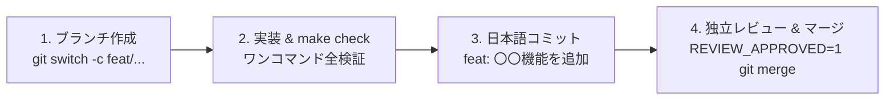

# AI-Native 開発ガイドライン & 他リポジトリ導入マニュアル

> 対象読者: 初めて本プロジェクトに触れる開発者、およびタスクを遂行するAIエージェント (Flash / Pro)

このドキュメントは、本プロジェクト（`project-base`）で確立された **AI駆動開発（AI-Native Development）の安全ガードレールと仕組み** を、誰でも迷わず理解し、他のあらゆるプロジェクトへ1分で導入できるようにするための公式手順書です。

---

## 1. コア理念: 「人間には寛容に、AIには厳格に」

AIエージェントは非常に強力ですが、放置すると「`main` ブランチに直接コミットする」「英語の乱雑なコミットを残す」「テストが壊れたままコードをプッシュする」といった暴走を起こします。

本システムでは、プロンプトによる「お願い」ではなく、**Gitフック（`.githooks/`）という物理的な防壁** によってAIの暴走を100%機械的に遮断します。

| 物理ガードレール | 何を防ぐか？ |
| :--- | :--- |
| **`pre-commit`** | `main` への直接コミット禁止。トピックブランチ（`feat/*` 等）を強制。 |
| **`pre-commit` (マージ時)** | `REVIEW_APPROVED=1` なしの勝手なマージコミットを物理遮断（独立レビューを強制）。 |
| **`commit-msg`** | 日本語文字（ひらがな・カタカナ・漢字）を含まないコミットを遮断（履歴の品質維持）。 |
| **`pre-push`** | `make check`（脆弱性・テスト・型検査・ビルド）が通っていない状態でのリモート送信を阻止。 |

---

## 2. 導入パターンA: 【新規】新しいアプリを作る場合（30秒）

新規プロジェクトを開始する時は、`project-base` を複製してセットアップコマンドを叩くだけです。

```bash
# 1. project-base をクローン (例: my-new-app という名前で作成)
git clone https://github.com/H-Oguma/project-base.git my-new-app
cd my-new-app

# 2. 初期セットアップスクリプトを実行
# (Git履歴の再初期化、プロジェクト名置換、フック登録、依存関係インストールが一括で行われます)
npm run setup
```

---

## 3. 導入パターンB: 【既存】すでにあるプロジェクトに後から入れる場合（1分）

すでに開発が進んでいる既存プロジェクト（`gbf-gw-calculator`, `discord-bot` など）にこの仕組みを移植する手順です。

### 🤖 AIエージェントに依頼する場合 (推奨・一番楽)
AI（Claude, Antigravity, Cursor等）に、以下の枠内のプロンプトをそのまま貼り付けて指示してください：

```text
/Users/kumato/Repository/project-base から以下のファイルをこのプロジェクトにコピーして適用してください。
1. .githooks/ (フォルダごとコピー)
2. setup-hooks.sh (ルートにコピー)
3. AGENTS.md (ルートにコピーし、タイトル等のプロジェクト名を本リポジトリ名に置換)
4. .agents/skills/advisor-planner/ (フォルダごとコピー)

コピー完了後、以下の手順を実行してください：
- ./setup-hooks.sh を実行してフックを有効化
- このプロジェクトの言語・スタックに合わせて Makefile の check ターゲット（テスト・Lint・ビルド）を整備
- make check を実行してすべてパスすることを確認
```

### 👨‍💻 人間が手動でサクッと行う場合 (コピペ用コマンド)
ターミナルを開き、以下のコマンドを順に実行してください：

```bash
# ① 対象の既存プロジェクトに移動 (例: gbf-gw-calculator)
cd /Users/kumato/Repository/gbf-gw-calculator

# ② project-base から安全装置一式をコピー
cp -r /Users/kumato/Repository/project-base/.githooks .
cp /Users/kumato/Repository/project-base/setup-hooks.sh .
mkdir -p .agents/skills
cp -r /Users/kumato/Repository/project-base/.agents/skills/advisor-planner .agents/skills/
cp /Users/kumato/Repository/project-base/AGENTS.md .

# ③ AGENTS.md 内のプロジェクト名を置換 (手動またはsed)
sed -i '' "s/project-base/$(basename $(pwd))/g" AGENTS.md

# ④ フックをローカルGitに登録 (実行権限付与と core.hooksPath 設定)
./setup-hooks.sh
```

---

## 4. 日常の開発フロー（AIとの共同開発プロトコル）

この仕組みが導入されたプロジェクトでは、AIも人間も以下の**4ステップ**で作業を進めます。



1. **ブランチを切る**:
   - `main` で直接編集してコミットしようとするとフックがエラーを吐きます。必ず `feat/xxx` や `fix/xxx` を作ります。
2. **作業したら `make check` を通す**:
   - AIに「実装が終わったら `make check` を通してください」と伝えます。テストや脆弱性チェックが1発で全自動実行されます。
3. **コミットする**:
   - 日本語の Conventional Commits（例: `feat: ログイン機能を追加`）でコミットします。
4. **プッシュとマージ**:
   - `git push` 時に自動で `make check` が走り、合格したコードだけがリモートに送られます。
   - `main` へマージする際は、レビュー承認フラグ（`REVIEW_APPROVED=1 git merge --no-ff <branch>`）を付けて安全に統合します。

---

## 5. よくあるトラブルシューティング

### Q1. `git commit` すると「mainブランチへの直接コミットは物理的に禁止されています」と怒られる
- **原因**: `main` ブランチにいます。
- **対処法**: `git switch -c feat/my-feature` で作業用ブランチを作成してください。

### Q2. `git commit` すると「日本語文字が含まれていません」と怒られる
- **原因**: コミットメッセージが英語のみになっています。
- **対処法**: `git commit -m "feat: ユーザー一覧表示機能の実装"` のように、日本語を含めてコミットしてください。

### Q3. 新しく clone してきた環境でフックが動いていない気がする
- **原因**: Gitのフック設定（`core.hooksPath`）はリポジトリ外（ローカルPC）に保存されるため、未登録の可能性があります。
- **対処法**: プロジェクトルートで `./setup-hooks.sh`（または `npm install`）を実行してください。
